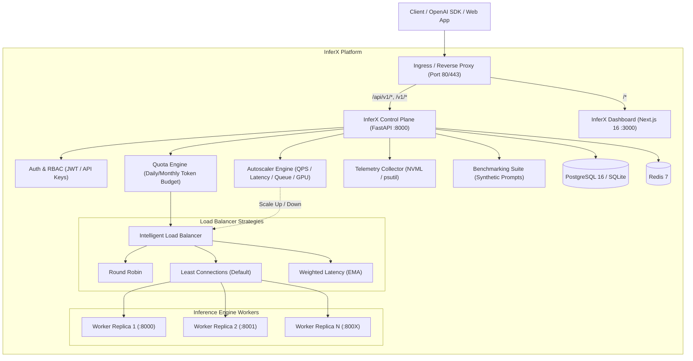

# InferX — Enterprise LLM Serving & Inference Control Plane

[](https://fastapi.tiangolo.com)
[](https://nextjs.org)
[](https://vllm.ai)
[](https://www.docker.com)
[](https://kubernetes.io)
[](LICENSE)

**InferX** is a production-grade, self-hosted Large Language Model (LLM) inference control plane and intelligent routing gateway. It unifies model registry management, downstream engine orchestration (vLLM, SGLang, TensorRT-LLM), multi-worker load balancing, dynamic autoscaling, real-time hardware telemetry, automated load benchmarking, and enterprise governance quotas.

---

## Architecture Overview



---

## Core Capabilities

- **OpenAI-Compatible Inference Gateway (`/v1/chat/completions`)**: Seamless drop-in replacement for any official OpenAI SDK, LangChain, LlamaIndex, or agentic workflow, supporting both Server-Sent Events (SSE) token streaming and atomic completions.
- **Intelligent Load Balancer & Replica Registry**: Dynamic pool manager routing across healthy downstream model workers using `least_connections`, `round_robin`, or `weighted_latency` with automated health degradation.
- **Dynamic Autoscaling Controller**: Automated scale-out/scale-in engine driven by real-time throughput ($QPS$), $P_{95}$ latency, queue depth, or physical GPU utilization with anti-flapping cooldown windows.
- **Real-Time GPU Hardware Telemetry**: Native NVIDIA Management Library (`pynvml`) integration reporting temperature, power, clock speed, VRAM allocation, and host resource load with graceful software fallback.
- **Synthetic Benchmarking & Load Testing Suite**: Multi-concurrency load generator with statistical percentiles ($P_{50}, P_{95}, P_{99}$), TTFT (Time-To-First-Token), TPOT/ITL (Inter-Token Latency), and peak memory tracking.
- **Enterprise Governance & Token Quotas**: Daily and monthly token consumption caps per user, API key, or tenant organization, with automatic UTC rollover and streaming SOC2 compliance audit log exports (CSV / JSON).
- **Modern Next.js 16 Dashboard**: Real-time management interface featuring an interactive Playground with live token ticker, Deployment Manager, Model Registry Explorer, and Analytics Charts.

---

## Quickstart Guide

### 1. Run with Docker Compose (Recommended)

To start the full production stack (PostgreSQL, Redis, Backend, and Frontend):

```bash
# Clone the repository
git clone https://github.com/Mrvikas06/InferX.git
cd InferX

# Launch all services
docker compose up -d --build
```

Access the application:
- **Web Dashboard**: [http://localhost:3000](http://localhost:3000)
- **FastAPI Control Plane**: [http://localhost:8000](http://localhost:8000)
- **Interactive Swagger Docs**: [http://localhost:8000/docs](http://localhost:8000/docs)
- **OpenAI Gateway**: `http://localhost:8000/v1`

---

### 2. Local Development Setup

#### Backend Setup
```bash
# Create and activate virtual environment
python -m venv .venv
source .venv/bin/activate  # On Windows: .venv\Scripts\activate

# Install dependencies
pip install -r backend/requirements.txt

# Start backend control plane (auto-initializes SQLite database in dev mode)
python -m uvicorn backend.app.main:app --host 127.0.0.1 --port 8000 --reload
```

#### Frontend Setup
```bash
cd frontend
npm install
npm run dev
```

---

### 3. Deploy to Kubernetes with Helm

```bash
# Deploy InferX Helm chart
helm upgrade --install inferx deploy/helm/inferx \
  --namespace inferx \
  --create-namespace \
  --set global.environment=production
```

Or deploy directly using Kustomize:
```bash
kubectl apply -k deploy/k8s/
```

---

## OpenAI SDK Usage Example

```python
from openai import OpenAI

client = OpenAI(
    base_url="http://localhost:8000/v1",
    api_key="ifx_live_your_key_here",  # Or any string in dev mode
)

response = client.chat.completions.create(
    model="meta-llama/Llama-3.3-70B-Instruct",
    messages=[
        {"role": "system", "content": "You are a helpful assistant."},
        {"role": "user", "content": "Explain KV-cache optimization in 3 bullet points."},
    ],
    temperature=0.7,
    max_tokens=256,
    stream=True,
)

for chunk in response:
    content = chunk.choices[0].delta.content
    if content:
        print(content, end="", flush=True)
```

---

## Key API Endpoints

| Method | Endpoint | Description |
| :--- | :--- | :--- |
| `POST` | `/v1/chat/completions` | OpenAI-compatible chat completion (streaming or atomic) |
| `GET` | `/v1/models` | List available models for OpenAI client auto-discovery |
| `GET` | `/api/v1/cluster/overview` | Cluster-wide worker replicas, throughput, and capacity |
| `POST` | `/api/v1/cluster/deployments/{id}/scale` | Manually scale worker replica instances |
| `GET` | `/api/v1/cluster/deployments/{id}/replicas` | Real-time worker health, inflight requests, and latency |
| `POST` | `/api/v1/cluster/deployments/{id}/autoscale/evaluate` | Trigger immediate autoscaling policy evaluation |
| `POST` | `/api/v1/benchmarks` | Launch asynchronous concurrency sweep load test |
| `GET` | `/api/v1/telemetry/overview` | Real-time NVML GPU metrics, memory, and rolling latencies |
| `GET` | `/api/v1/governance/quotas` | Manage token budget quotas per user or tenant |
| `GET` | `/api/v1/audit-logs/export` | Download compliance audit logs in streaming CSV or JSON |

---

## Verification & Testing

InferX features an automated test harness covering unit, integration, and end-to-end platform workflows:

```bash
# Run full pytest test suite (60 tests)
python -m pytest backend/tests -v

# Run type checker
cd backend && npx pyright

# Run production smoke test script
python scripts/prod_smoke_test.py --base-url http://127.0.0.1:8000
```

---

## License

This project is licensed under the [MIT License](LICENSE).
